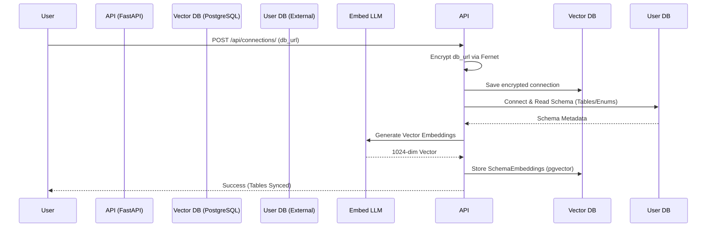
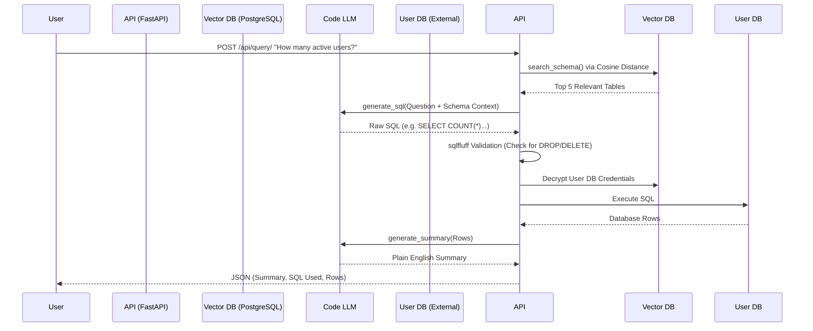

# AI SQL Service

A powerful FastAPI backend that connects to user databases and uses Natural Language Processing (via LLMs) to generate, validate, and execute read-only SQL queries.

This service allows users to "chat" with their database in plain English.

---

## 🚀 Features

- **JWT Authentication**: Secure signup, login, and token rotation with refresh cookies.
- **Email Verification**: Real OTP verification emails sent via SMTP.
- **Secure Connections**: Database credentials are encrypted using Fernet symmetric encryption and never stored in plain text.
- **Schema Scanning (RAG)**: Automatically scans connected databases (Tables, Columns, Enums) and generates vector embeddings to power context-aware LLM queries.
- **Safe SQL Generation**: Strict prompt engineering and `sqlfluff` validation ensure only `SELECT` (read-only) queries are executed against the database.
- **Human Summarization**: Query results are returned alongside an AI-generated plain English summary.

---

## 🏗️ Architecture Flow

### 1. Database Connection & Schema Scanning Flow

When a user connects a database, the system encrypts the credentials and scans the schema to create AI embeddings for future context.



### 2. Natural Language Query Flow

When a user asks a question, the system finds the relevant tables, generates SQL, validates safety, executes it, and summarizes the output.



---

## 📁 File Structure

```text
ai-service/
├── app/
│   ├── api/
│   │   ├── auth_routes.py         # Signup, Login, Email Verify, Refresh
│   │   ├── connection_routes.py   # Add DB, Sync/Rescan DB
│   │   ├── query_routes.py        # NL to SQL Query Execution
│   │   ├── routes.py              # Main router index
│   │   └── dependencies.py        # JWT Auth dependency injections
│   ├── core/
│   │   ├── config.py              # Pydantic environment settings
│   │   └── prompts.py             # Strict LLM Prompt Engineering templates
│   ├── db/
│   │   ├── connection.py          # SQLAlchemy engine and session setup
│   │   ├── models.py              # SQLAlchemy DB models (Users, Connections, Logs)
│   │   └── vector_store.py        # pgvector schema embedding storage and RAG search
│   ├── models/
│   │   └── auth_models.py         # Pydantic schemas for request/response validation
│   ├── services/
│   │   ├── auth_service.py        # bcrypt hashing, JWT token generation, OTPs
│   │   ├── email_service.py       # smtplib email sender for OTPs
│   │   ├── embedding.py           # Mistral embedding generation
│   │   ├── encryption.py          # Fernet symmetric encryption for DB URLs
│   │   ├── query_executor.py      # Executes generated SQL on target databases
│   │   ├── schema_scanner.py      # Introspects external DBs for schemas/enums
│   │   ├── sql_generator.py       # Calls Gemini to convert text to SQL
│   │   ├── summarizer.py          # Calls Gemini to summarize data rows
│   │   └── validator.py           # sqlfluff read-only SQL validation
│   └── main.py                    # FastAPI application entry point
├── .env.example                   # Environment variable template
├── requirements.txt               # Python dependencies
└── README.md                      # This file
```

---

## ⚙️ Local Setup

1. **Clone & Virtual Environment:**

   ```bash
   python -m venv venv
   source venv/bin/activate  # On Windows: venv\Scripts\activate
   ```

2. **Install Dependencies:**

   ```bash
   pip install -r requirements.txt
   ```

3. **Environment Variables:**
   - Copy `.env.example` to `.env`
   - Fill in your database URL (needs `pgvector` extension)
   - Add your Gemini API Key
   - Add your SMTP Credentials (e.g., Gmail App Password) for OTP emails.

4. **Initialize Database:**

   ```bash
   python init_db.py
   ```

5. **Run the Server:**
   ```bash
   python -m app.main
   ```
   _The Swagger UI will be available at `http://127.0.0.1:8000/docs`._
