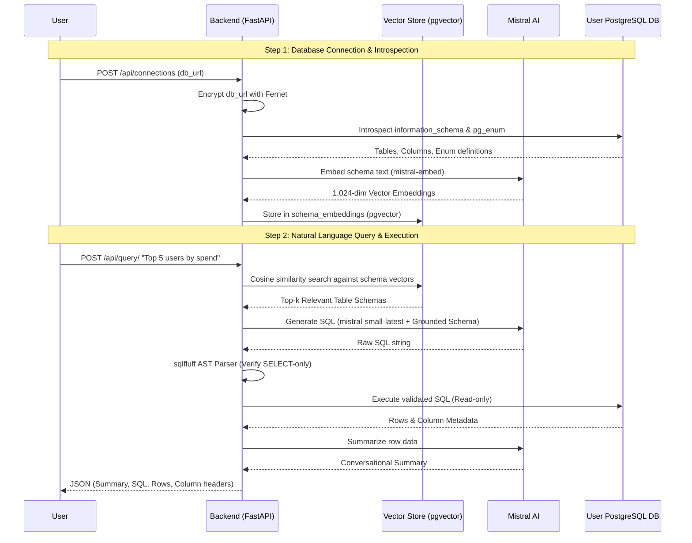

# DataWhisper (ai-sql-service)

A full-stack, natural-language-to-SQL platform that connects to PostgreSQL databases, interprets user questions in plain English, and generates, validates, and executes read-only SQL queries with AI summaries.

---

## 🚀 Key Features

- **Schema-Aware RAG**: Automatically introspects connected databases (tables, column data types, and PostgreSQL `pg_enum` types) and stores **1,024-dimension** Mistral vector embeddings in `pgvector` for context-grounded retrieval.
- **Sub-Second Median Latency (~1.2s)**: Low-latency query pipeline combining vector similarity search with `mistral-small-latest`.
- **Hard AST-Level Query Safety**: Validates generated SQL through `sqlfluff` Abstract Syntax Tree (AST) parsing to guarantee that only `SELECT` (read-only) queries execute, neutralizing SQL injection and write/delete mutations.
- **Credential Protection**: Database connection URLs are encrypted at rest using Fernet symmetric encryption and never stored in plain text.
- **Enterprise Authentication**: User auth with bcrypt password hashing, JWT access/refresh token rotation with HTTP-only cookies, and real 6-digit OTP verification via SMTP email.
- **Human Summaries & Data Tables**: Tabular query results paired with concise, natural-language analytical summaries.

---

## 🏗️ Architecture & Query Pipeline



---

## 🛠️ Tech Stack

- **Backend Framework**: FastAPI (Python 3.11+, ASGI / Uvicorn)
- **Database & Vectors**: PostgreSQL, `pgvector` extension, SQLAlchemy ORM
- **AI Models & Frameworks**: LangChain, Mistral AI (`mistral-small-latest` for SQL/Summaries, `mistral-embed` for 1,024-dim vector embeddings)
- **SQL Parsing & Security**: `sqlfluff` (AST-based SQL linter and grammar validator), `cryptography.fernet`
- **Authentication**: JWT (Access + Refresh tokens), `passlib` (bcrypt), SMTP email verification (OTP)
- **Frontend**: React (Vite), TanStack Query, Tailwind CSS, Axios

---

## 📁 Repository Structure

```text
├── ai-service/
│   ├── app/
│   │   ├── api/
│   │   │   ├── auth_routes.py         # Signup, login, OTP verify, token refresh
│   │   │   ├── connection_routes.py   # Connection management & schema introspection
│   │   │   ├── query_routes.py        # Natural language to SQL query execution
│   │   │   ├── routes.py              # Root router aggregation
│   │   │   └── dependencies.py        # JWT authentication dependencies
│   │   ├── core/
│   │   │   ├── config.py              # Pydantic v2 Settings (environment validation)
│   │   │   └── prompts.py             # Grounded prompt engineering templates
│   │   ├── db/
│   │   │   ├── connection.py          # SQLAlchemy engine & session factory
│   │   │   ├── models.py              # App tables (Users, Connections, QueryLogs)
│   │   │   └── vector_store.py        # pgvector SchemaEmbedding table & search
│   │   ├── models/
│   │   │   ├── auth_models.py         # Request/response Pydantic models
│   │   │   └── request_models.py      # Query & connection schemas
│   │   └── services/
│   │       ├── auth_service.py        # Password hashing & JWT generation
│   │       ├── email_service.py       # SMTP OTP delivery
│   │       ├── embedding.py           # Mistral embedding wrapper
│   │       ├── encryption.py          # Fernet symmetric credential encryption
│   │       ├── query_executor.py      # Target database execution engine
│   │       ├── schema_scanner.py      # System catalog introspection & enum mapping
│   │       ├── sql_generator.py       # LangChain + Mistral SQL generation
│   │       ├── summarizer.py          # Query result summarization
│   │       └── validator.py           # sqlfluff AST read-only safety guard
│   └── tests/                         # Unit & integration test suites
└── frontend/                          # Vite + React client
```

---

## 🚦 Getting Started

### 1. Prerequisites
- Python 3.11+
- PostgreSQL instance with `pgvector` extension enabled
- Node.js 18+ (for frontend)
- Mistral AI API Key

### 2. Backend Setup
```bash
cd ai-service
python -m venv venv
source venv/bin/activate  # On Windows: venv\Scripts\activate
pip install -r requirements.txt

cp .env.example .env
# Configure DATABASE_URL, MISTRAL_API_KEY, FERNET_KEY, JWT_SECRET in .env

# Initialize database schema & vector tables
python init_db.py

# Run FastAPI backend
uvicorn app.main:app --reload --port 8000
```

### 3. Frontend Setup
```bash
cd ../frontend
npm install
npm run dev
```

---

## 🛡️ Security Architecture

1. **AST Validation (sqlfluff)**: Generated queries are parsed into an Abstract Syntax Tree. Any query containing DML/DDL expressions (`DROP`, `DELETE`, `UPDATE`, `INSERT`, `ALTER`, `TRUNCATE`) or multiple chained statements is blocked before hitting the network.
2. **Read-Only Target Connection**: Target databases are queried with strict statement timeouts and read-only execution constraints.
3. **Fernet Encryption**: Target database passwords are symmetrically encrypted using Fernet (AES-128-CBC + SHA256 HMAC) before persisting to the metadata database.
